# WinForge — novo visual WF-188

**Prévia WF-189 · 27/10/2026**

[📷 Galeria com 32 fotos](previews/2026-10-27/WF188-GALERIA.md) · [▶ Vídeo completo — 1min36s](https://raw.githubusercontent.com/GunZ999/WinForge-Downloads/preview-wf175-20261027/previews/2026-10-27/WinForge-visual-WF188.mp4) · [▶ Efeitos — 12s](https://raw.githubusercontent.com/GunZ999/WinForge-Downloads/preview-wf175-20261027/previews/2026-10-27/WinForge-WF188-efeitos.mp4)

[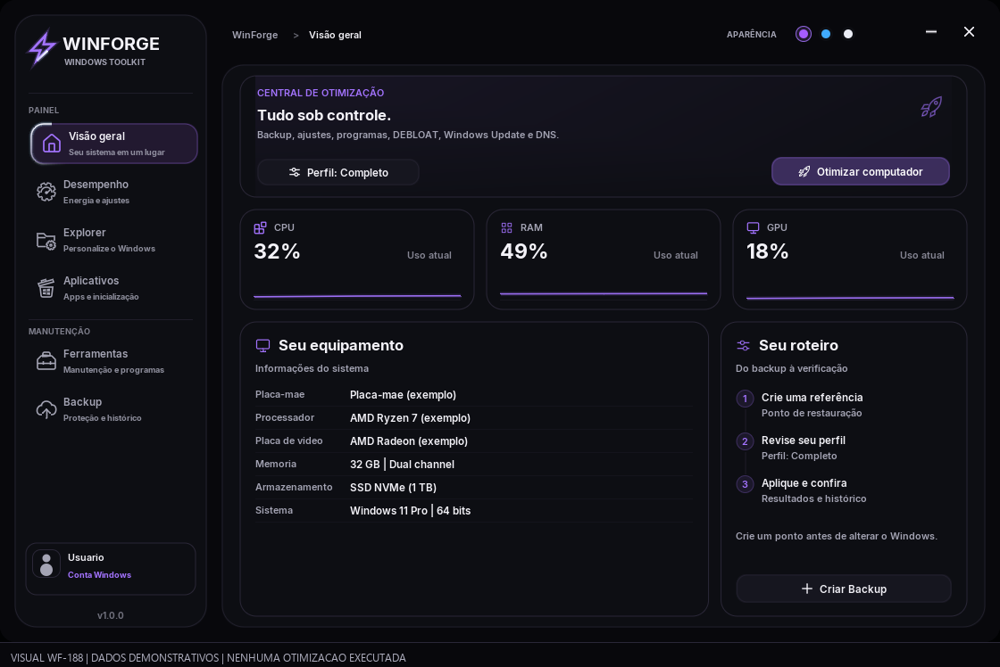](previews/2026-10-27/WF188-HOME.png)

Nova navegação, HOME, cartões, janelas e temas Violeta, Azul e Claro. Release x64 compilada. Mídias do renderer real em uma cópia isolada com dados demonstrativos identificados; nenhuma otimização executada. Backup anterior, main e Latest preservados.

---

## Arquivo da prévia anterior — WF-186

# WinForge — visual atual WF-186

**Prévia WF-187 · 27/10/2026**

[📷 Galeria com 25 fotos](previews/2026-10-27/WF186-GALERIA.md) · [▶ Vídeo completo — 1min12s](https://raw.githubusercontent.com/GunZ999/WinForge-Downloads/preview-wf175-20261027/previews/2026-10-27/WinForge-visual-WF186.mp4) · [▶ Efeitos — 12s](https://raw.githubusercontent.com/GunZ999/WinForge-Downloads/preview-wf175-20261027/previews/2026-10-27/WinForge-WF186-efeitos.mp4)

[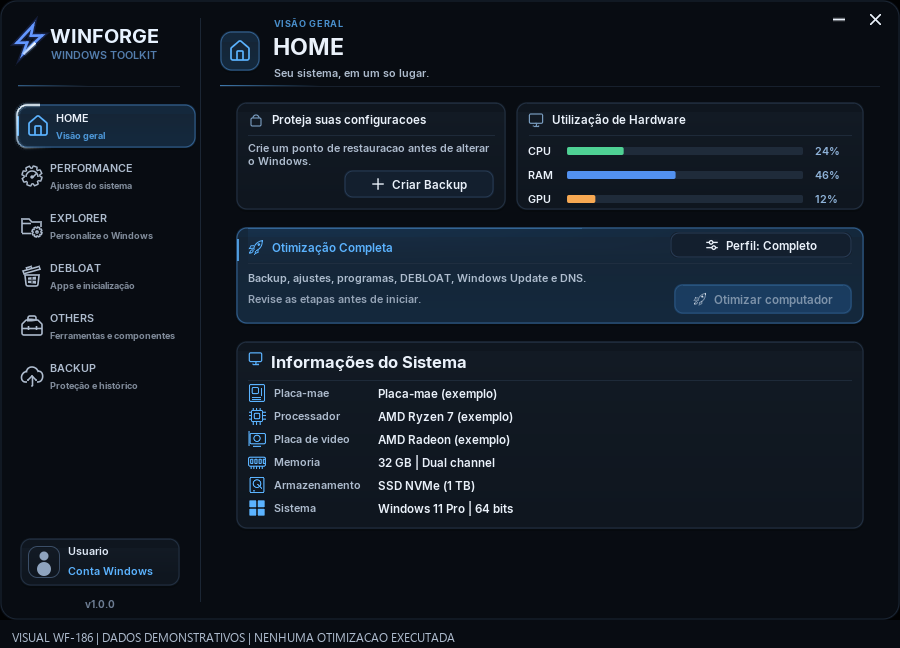](previews/2026-10-27/WF186-HOME.png)

Renderer real, dados demonstrativos identificados e nenhuma otimização executada. Somente a cópia visual foi compilada; o executável normal, o backup WF-186, main e Latest continuam preservados.

---

## Arquivo da prévia anterior — WF-175

**Visual WF-175 · Capturas WF-176 · 27/10/2026**

Fotos reais da interface C++/Dear ImGui/DirectX 11 compilada em cópia isolada. Dados demonstrativos identificados; nenhuma otimização, instalação, limpeza ou restauração executada. A compilação normal Release x64 também foi concluída. Esta galeria não é teste funcional dos ajustes do Windows.

Clique nas fotos para ampliar. Main e a release Latest não foram alteradas.

## Vídeo completo — 1min39s

**[▶ Assistir/baixar o vídeo MP4](https://raw.githubusercontent.com/GunZ999/WinForge-Downloads/preview-wf175-20261027/previews/2026-10-27/WinForge-WF175-tour-completo.mp4)**

[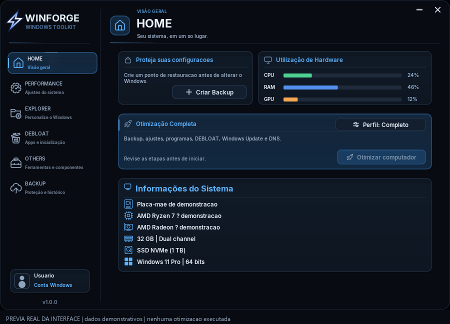](previews/2026-10-27/WinForge-WF175-tour-completo.mp4)

Passeio pela interface real compilada, com navegação, rolagem, efeitos, todas as abas principais, subabas, perfis, histórico, DNS e janelas de backup/otimização. Roteiro, cursor, hardware e estados são demonstrativos, identificados durante todo o vídeo. Nenhuma otimização foi executada no Windows. MP4 H.264, 30 fps, 900 × 676, cerca de 2,5 MB.

### Capítulos

| Tempo | Tela |
|---|---|
| 0:00 | HOME |
| 0:03 | Hover e selecao da navegacao |
| 0:06 | PERFORMANCE / cartoes |
| 0:09 | PERFORMANCE / rolagem |
| 0:12 | DNS / ranking demonstrativo |
| 0:15 | EXPLORER / personalizacoes |
| 0:18 | DEBLOAT / aplicativos |
| 0:21 | Limpeza do sistema |
| 0:24 | Autoruns / programas |
| 0:27 | Autoruns / servicos |
| 0:30 | Autoruns / tarefas agendadas |
| 0:33 | Windows Update |
| 0:36 | Dependencias |
| 0:39 | Programas |
| 0:42 | FIX WINDOWS |
| 0:45 | BACKUP / pontos |
| 0:48 | Excluir ponto / confirmacao |
| 0:51 | Restaurar ponto / confirmacao |
| 0:54 | Criar Backup |
| 0:57 | Perfil Basico |
| 1:00 | Perfil Personalizado / ajustes |
| 1:03 | Perfil Personalizado / remover apps |
| 1:06 | Perfil Personalizado / instalar |
| 1:09 | Otimizacao / revisao das etapas |
| 1:12 | Otimizacao / progresso demonstrativo |
| 1:15 | Historico / todas |
| 1:18 | Historico / PERFORMANCE |
| 1:21 | Historico / EXPLORER |
| 1:24 | Historico / DEBLOAT |
| 1:27 | Historico / OTHERS |
| 1:30 | Notificacao de aplicacao |
| 1:33 | Notificacao de remocao |
| 1:36 | HOME / encerramento |

## HOME

## PERFORMANCE

[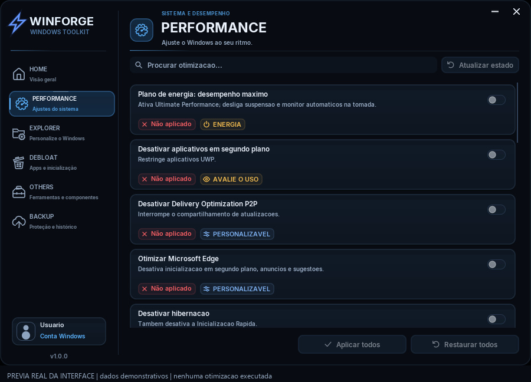](previews/2026-10-27/02-performance.jpg)

## EXPLORER

[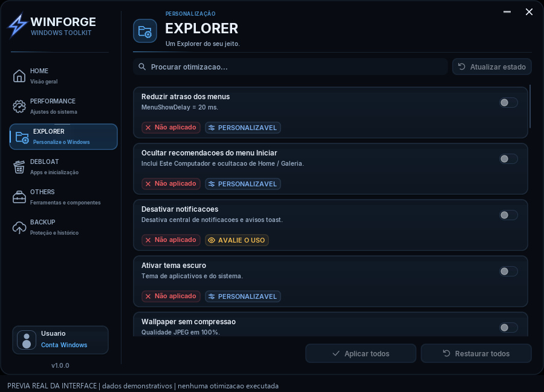](previews/2026-10-27/03-explorer.jpg)

## DEBLOAT

[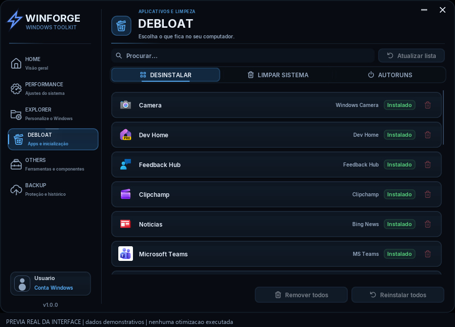](previews/2026-10-27/04-debloat.jpg)

## Limpeza do sistema

[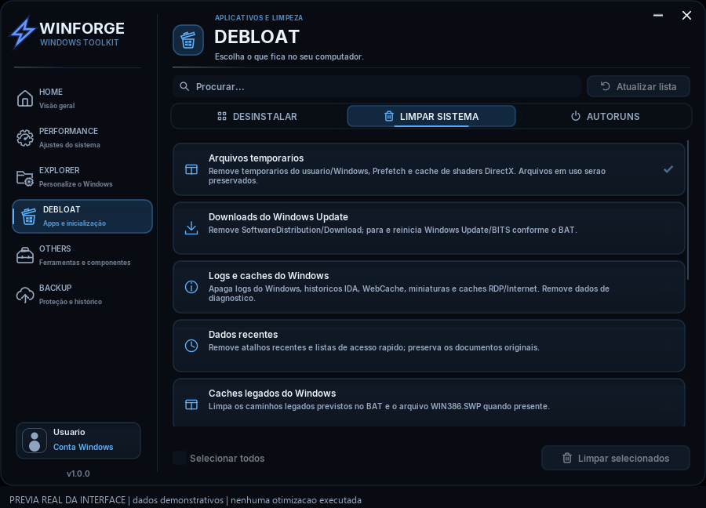](previews/2026-10-27/05-limpeza.jpg)

## Autoruns

[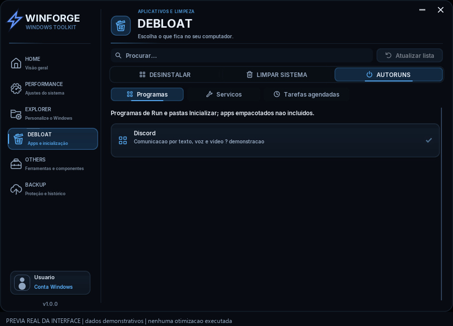](previews/2026-10-27/06-autoruns.jpg)

## Windows Update

[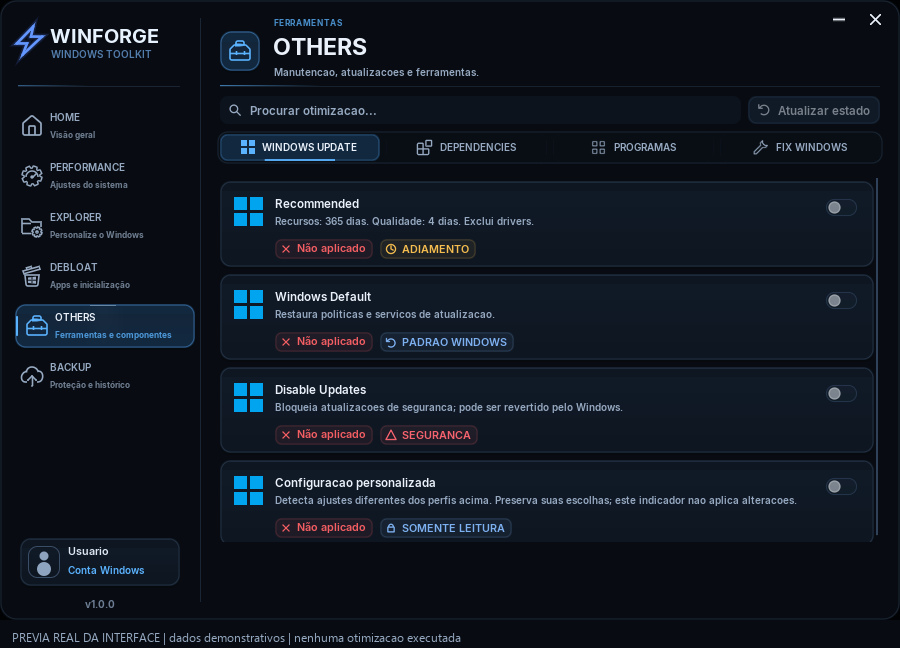](previews/2026-10-27/07-windows-update.jpg)

## Dependências

[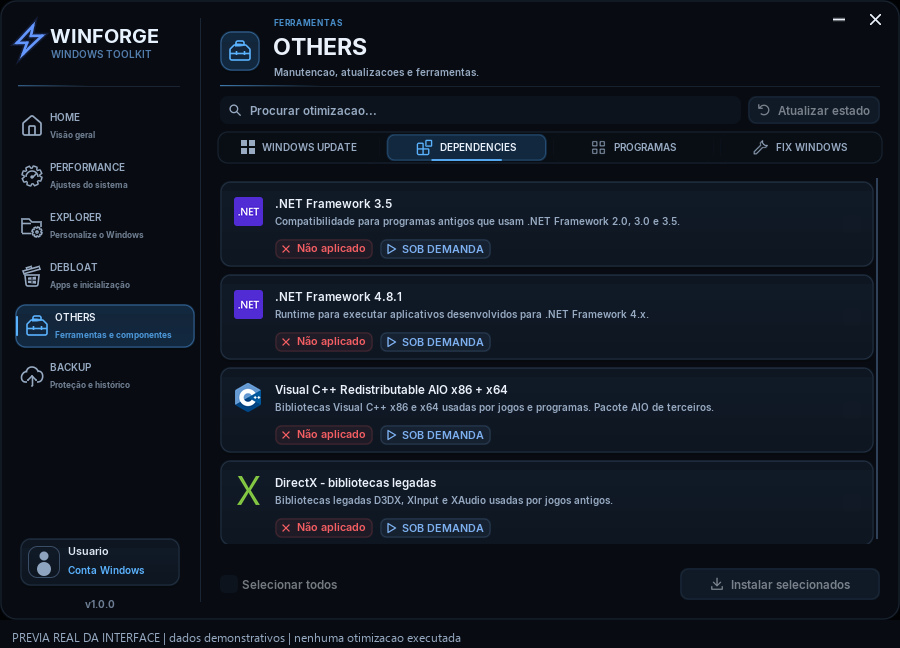](previews/2026-10-27/08-dependencias.jpg)

## Programas

[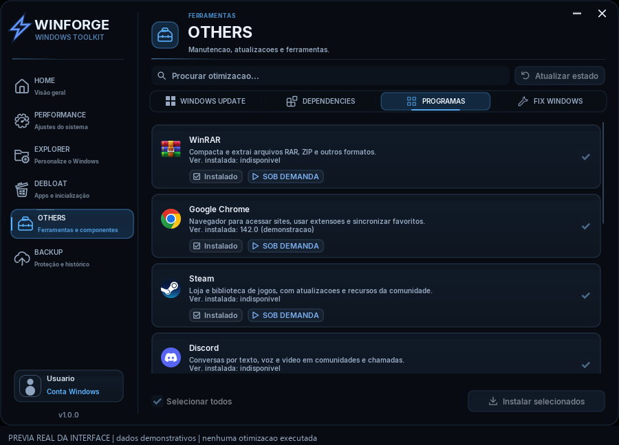](previews/2026-10-27/09-programas.jpg)

## FIX WINDOWS

[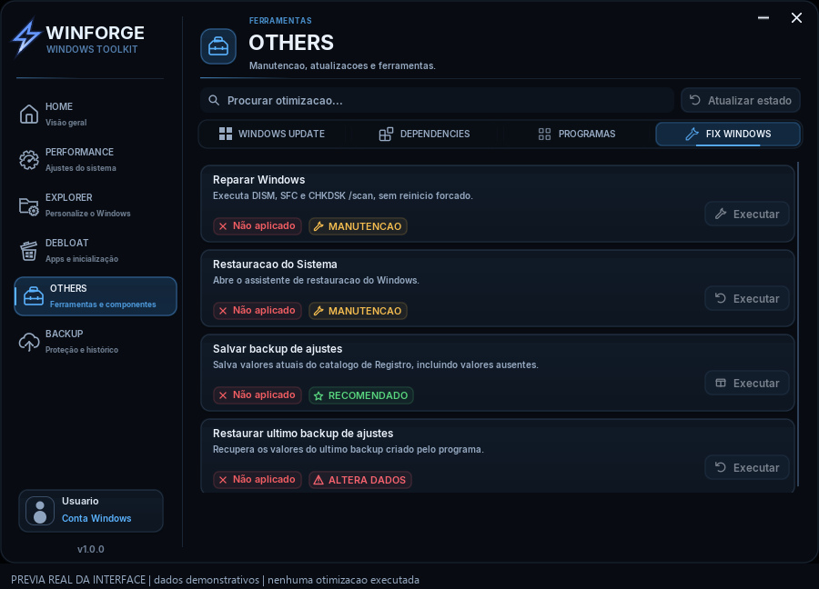](previews/2026-10-27/10-fix-windows.jpg)

## BACKUP

[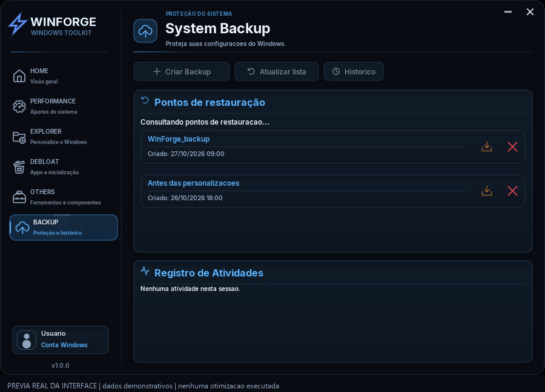](previews/2026-10-27/11-backup.jpg)

## Perfil de otimização

[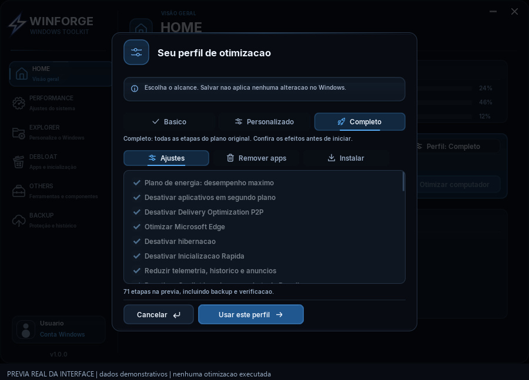](previews/2026-10-27/12-perfil.jpg)

## Confirmação da Otimização Completa

[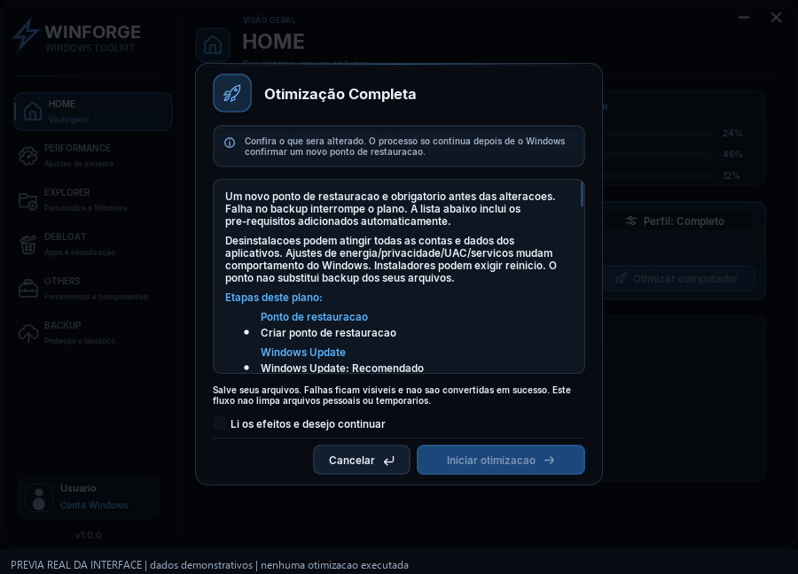](previews/2026-10-27/13-confirmacao-otimizacao.jpg)

## Progresso da otimização

[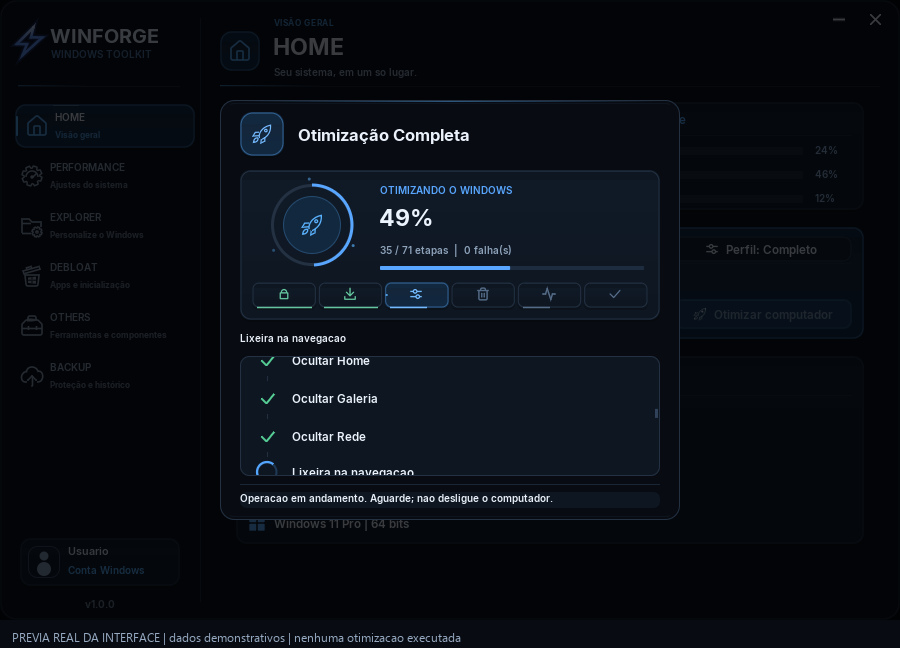](previews/2026-10-27/14-progresso.jpg)

## Criar Backup

[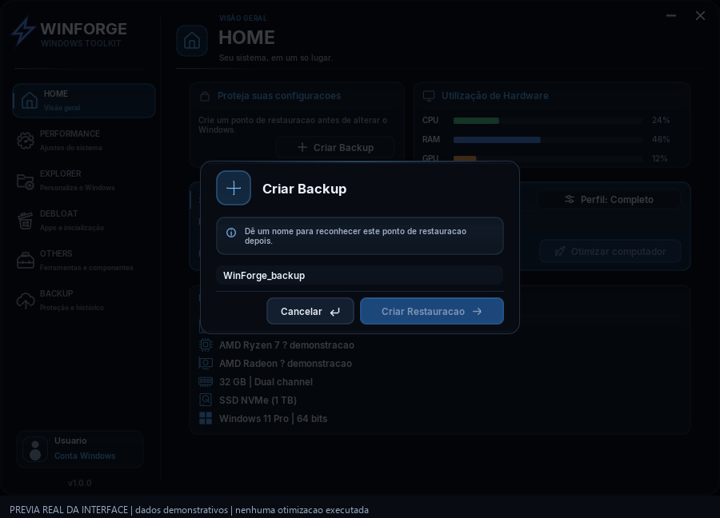](previews/2026-10-27/15-criar-backup.jpg)

