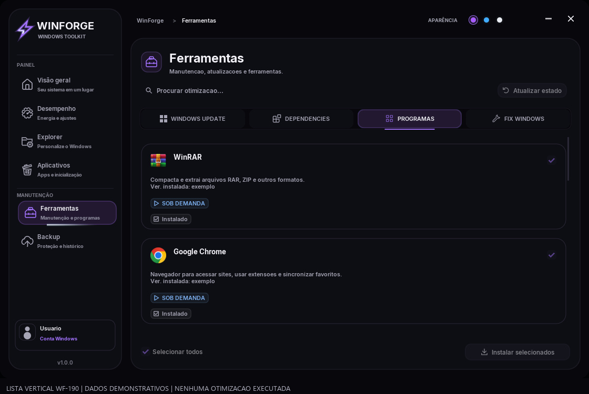
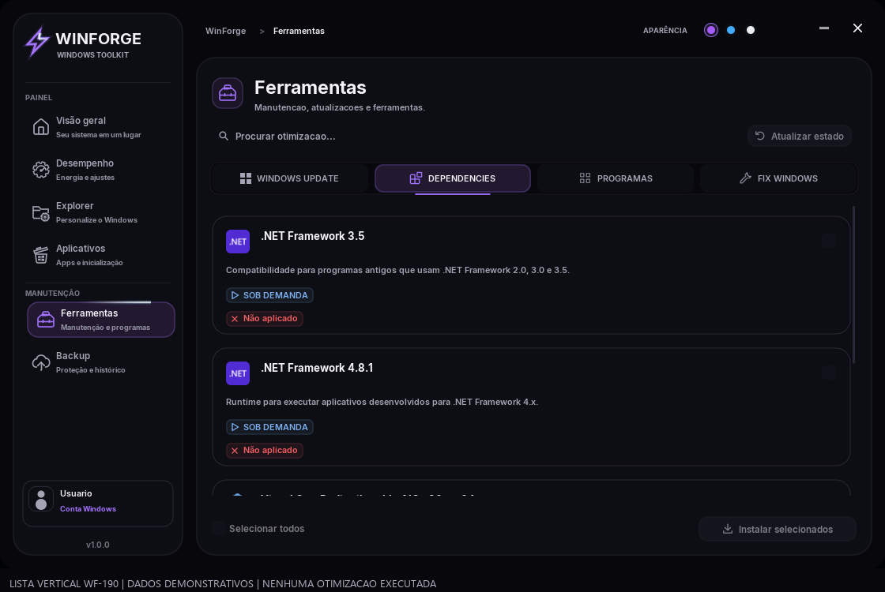
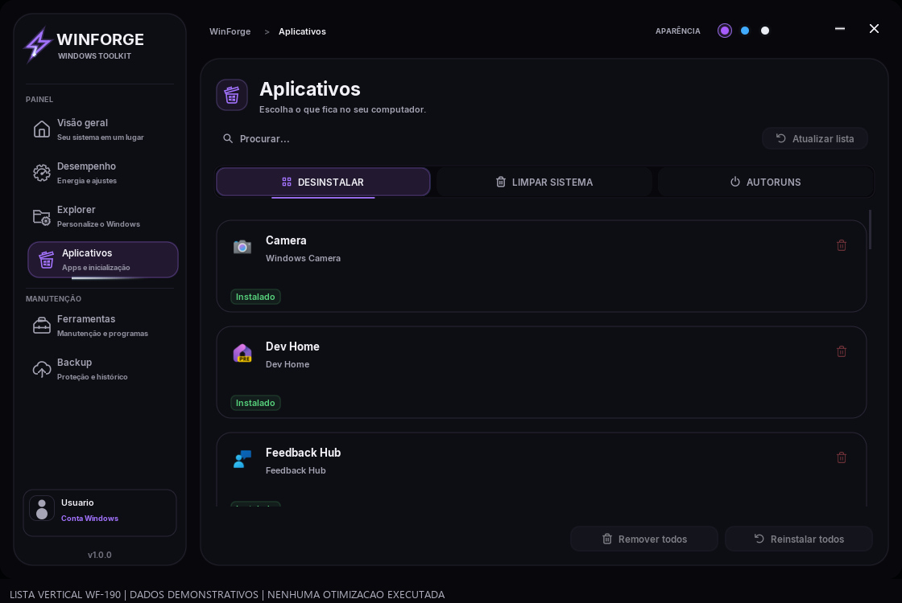

# WinForge — listas verticais WF-190

Programas, Dependências e Desinstalar voltaram a uma coluna. Capturas reais do programa em cópia isolada, com dados demonstrativos identificados. Nenhuma otimização foi executada. A proposta de paginação das grades de ajustes ainda não foi aplicada.

## Programas

## Dependências

## Desinstalar aplicativos

